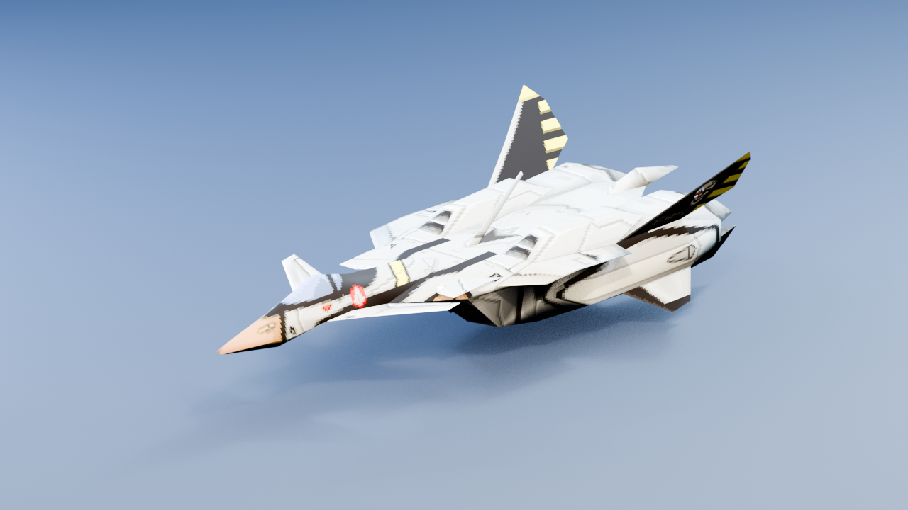
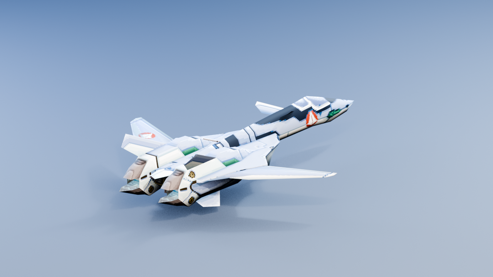
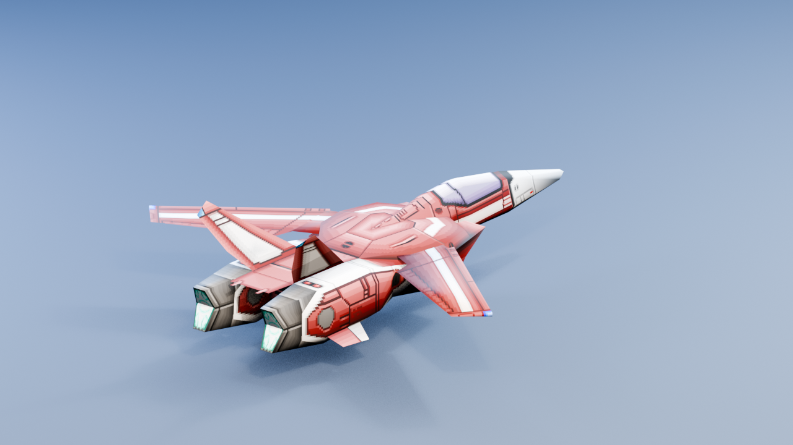
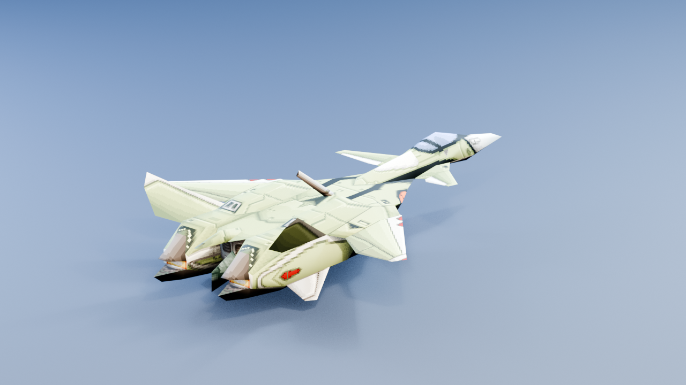

# Macross VF-X2 Blender importer

Blender 5.2 add-on for importing model assets from **Macross VF-X2
(SLPS-02237)**:

- standard PlayStation `.TMD` models;
- VFX2 `.MOD` containers with every validated embedded TMD form;
- standard `.TIM` textures, including TIM images embedded in MOD files; and
- VFX2 `.TIX` VRAM-upload streams.

No game data is included. Extract assets from your own legally obtained copy.

## Sample imports

| Self-contained MOD | Standalone TMD with mission TIX |
|---|---|
|  |  |
| `MOD/VF11.MOD`, first embedded form with its own TIM textures | `DATA01/ALLY010.TMD` with `DATA01/IMAGE010.TIX` |

| Standalone TMD | Standalone TMD |
|---|---|
|  |  |
| `DATA04/ENEMY042.TMD` with `DATA04/IMAGE040.TIX` | `DATA04/ENEMY043.TMD` with `DATA04/IMAGE040.TIX` |

These Blender Eevee renders were generated from a locally supplied legal disc.
Only the documentation PNGs are retained; the extraction and render workflow
uses temporary asset files and removes them when Blender exits.

## Install

Build an installable Blender extension from the repository root:

```powershell
& "D:\Blender Foundation\Blender 5.2\blender.exe" `
    --command extension build `
    --source-dir .\io_scene_vfx2 `
    --output-dir .\dist
```

In Blender, open **Edit > Preferences > Get Extensions**, use the menu's
**Install from Disk** action, and select the generated ZIP from `dist`.

For development, the `io_scene_vfx2` directory can also be added to Blender's
scripts/addons directory as a conventional add-on package.

## Import models

Use **File > Import > Macross VF-X2 Model (.tmd/.mod)**.

Import options:

| Option | Behavior |
|---|---|
| Texture Bank | Optional `.TIX`/`.TIM` file or directory to load into emulated PS1 VRAM |
| Auto-find Textures | Selects the largest adjacent TIX, or all adjacent TIM files when no TIX exists |
| Scale | Blender units per PlayStation model unit; defaults to `0.01` |
| Show All MOD Forms | Shows every embedded TMD form instead of hiding alternatives after the first |

MOD imports apply an explicitly selected or auto-discovered texture bank
first, then overlay the standard TIM images embedded in the MOD. This matches
the useful load order for the self-contained Variable Fighter files while
still allowing mission texture banks to supply textures absent from smaller
MOD files.

Each MOD form is placed in its own collection. Alternative forms are hidden
from the viewport and render by default so they do not overlap. Toggle their
collections to inspect them.

## Texture handling

The importer reconstructs 1024x512 PlayStation VRAM, applies every upload
rectangle, and resolves each polygon's TPage and CLUT values. It supports
4-bit, 8-bit, and 15-bit texture pages, BGR555 color, transparent color zero,
and an alpha approximation for the PS1 semitransparency bit.

Missing texture pages render as a magenta checkerboard. For standalone TMD
files, explicitly choose the mission's `IMAGE*.TIX` if automatic selection
does not identify the intended bank.

## Current scope

- Static polygon geometry, UVs, colors, normals, materials, and textures are
  imported.
- VFX2 MOD animation and transformation data outside the embedded TMD/TIM
  blocks is preserved only as source data; it is not converted to an armature
  or Blender actions.
- PS1 blend equations are approximated with Blender alpha materials.
- Texture-window state is not represented in TMD packets and is not emulated.
- The add-on is read-only; it does not export TMD, MOD, TIM, or TIX.

## Development

Run the format tests with:

```powershell
python -m unittest discover -s .\tests -v
```

Regenerate the sample gallery from a legal raw Track 1 image with:

```powershell
& "D:\Blender Foundation\Blender 5.2\blender.exe" `
    --background `
    --factory-startup `
    --python .\tools\render_samples.py `
    -- `
    --disc-image "F:\path\to\Macross VF-X2 (Japan) (Track 1).bin" `
    --output-dir .\docs\images
```

The parser in `io_scene_vfx2/formats.py` has no Blender dependency. Blender
headless integration can be exercised against locally extracted assets
without copying those assets into this repository.
